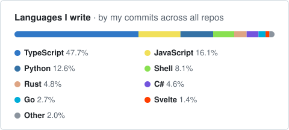

# Hi, I'm Wistara 👋

**Full-stack engineer** · Informatics Engineering at [ITS](https://www.its.ac.id) · Indonesia

I build across the stack: production web apps running at the edge, desktop ground-control software and real-time video pipelines for UAVs, and Linux app packaging on the side.

### 🚀 Featured work

| Project | What it is | Stack |
|---|---|---|
| **[Padelix Indonesia](https://padelix.co.id)** | Company site with a custom CMS, audit logging and edge caching. I designed, built and deployed it end to end. | Next.js · Drizzle · Neon Postgres · Cloudflare Workers |
| **Bayucaraka GCS** | Desktop ground control station for ITS's UAV team. Successor to the team's web GCS. *Lead developer & architect.* | Rust · Tauri v2 · SvelteKit |
| **Bayucaraka GCS (web)** | The previous ground control station: live map, telemetry and mission control. *Top frontend contributor.* | React · TypeScript · OpenLayers · Flask |
| **Veldora Server** | Low-latency ground server for airborne video: WebRTC ingest, MJPEG output, supervised Python inference workers. | Go · Pion WebRTC · Python |
| **[TD Wattmeter Suite](https://github.com/wistarabanyukayana/Bayucaraka-TD-Wattmeter)** | Taps a commercial wattmeter's LCD bus non-invasively and streams the readings as real-time telemetry. | Arduino · Electron · Web Serial |
| **[Incident Response Portfolio](https://github.com/wistarabanyukayana/incident-response-portfolio)** | Investigated a live GoPhish phishing site and got it taken down. | DNS & infra forensics |

Bayucaraka projects are private team repositories.

I've also built client sites for a travel agency, an umroh agency, an F&B point-of-sale system and a high school.

### 🧩 Open source

- **[DBeaver Community on Flathub](https://github.com/flathub/io.dbeaver.DBeaverCommunity)**: I help maintain the Flatpak package (55+ commits upstream).

### 🛠️ Stack

**Primary** 

**I also ship in** 

### 📫 Find me

[Portfolio](https://wistarabanyukayana.github.io) · [LinkedIn](https://www.linkedin.com/in/wistara-banyu-kayana) · [wisthara.banyu.kayana@gmail.com](mailto:wisthara.banyu.kayana@gmail.com)
